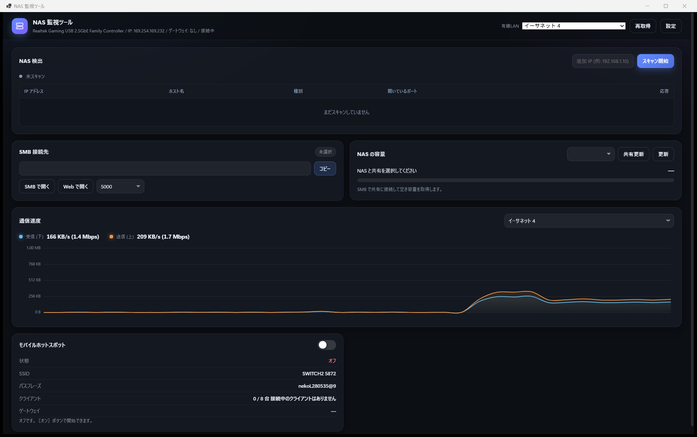

# NAS WATCH (NasWatcher)

イーサーネットから NAS の IP アドレスを自動取得し、**1 ページ**で以下の操作ができるデスクトップアプリです。
UI は HTML / CSS / JavaScript (WebView2) で実装しており、バックエンドは .NET 10 (C#) です。



> 📖 詳しい解説は **[機能紹介.md](機能紹介.md)** を参照してください。

## 機能

| 機能 | 説明 |
| --- | --- |
| **NAS の IP 取得** | 選択した有線LANアダプターのサブネットを走査 (ARP テーブル + /24 スキャン)。SMB(445) / DSM(5000,5001) / Web(80,443,8080) / SSH(22) ポートを並列プローブして NAS 候補を分類します。逆引き DNS でホスト名も取得します。 |
| **NAS へのアクセス** | 検出結果から選ぶだけで SMB パス (`\\192.168.1.10`) が自動入力されます。`SMB で開く` はエクスプローラー、`Web で開く` は既定のブラウザーを起動します。 |
| **NAS の容量** | SMB (`WNetAddConnection2` + `GetDiskFreeSpaceEx`) で共有を自動列挙し、空き容量を取得して使用率バーと使用済み/合計を表示します。認証は設定した方式に加えて「ゲスト」「現在ユーザー」も自動で試します。共有が列挙できないときは共有名を直接入力して取得できます。失敗時は Win32 エラーコードと原因・対処を表示します。 |
| **送信・受信速度** | 各 NIC の秒単位の転送量を 1 秒間隔で計測し、Canvas に滑らかなグラフで描画します (直近 2 分)。 |
| **モバイルホットスポット** | Windows Runtime (`NetworkOperatorTetheringManager`) でオン/オフを切り替え。SSID・パスフレーズ・接続クライアント・ゲートウェイ IP を表示します。 |
| **SMB パスのコピペ** | `\\IP` / `\\IP\共有名` をそのままクリップボードへコピーできます。 |

## 動作環境

- Windows 10 (2004 以降) / Windows 11
- [.NET 10 ランタイム不要] 自己完結型 (自己-contained) の単一 exe
- **Microsoft Edge WebView2 Runtime** が必要です (Windows 11 / 最新の Windows 10 には標準で入っています)。
  未インストールの場合は <https://developer.microsoft.com/microsoft-edge/webview2/> から入手してください。

## 使い方

1. `publish\NasWatcher.exe` (またはビルドした `NasWatcher.exe`) を起動します。
2. ヘッダーの「有線LAN」ドロップダウンで探索したいアダプターを選びます。
3. **スキャン開始** を押すとサブネット内の NAS 候補が一覧に出ます。
4. 一覧から NAS を選ぶと、右側の「NAS の容量」に共有と空き容量、左下の「SMB 接続先」に
   コピペ用のパス (`\\IP\共有名`) が入ります。
5. 「モバイルホットスポット」のスイッチで共有の ON / OFF を切り替えます。
6. 認証が必要な NAS は「設定」ボタンから認証方式 (現在ユーザー / ゲスト / ユーザー名とパスワード) を指定します。
   共有名の入力欄は手入力もできるので、列挙できない場合はそのまま共有名を入力して［更新］を押します。

### 設定ファイル

| 場所 | 内容 |
| --- | --- |
| `%APPDATA%\NasWatcher\settings.json` | NAS の IP / 共有名 / 認証情報 / ポートなどの設定 |
| `%LOCALAPPDATA%\NasWatcher\naswatcher.log` | 実行ログ |
| `%LOCALAPPDATA%\NasWatcher\webview` | WebView2 のユーザーデータ |

## 開発

```
# ビルド
dotnet build -c Release

# 実行
dotnet run -c Release

# 単一 exe として publish (publish\NasWatcher.exe)
dotnet publish -c Release -o publish
```

### プロジェクト構成

```
NasWatcher/
├─ Program.cs                 エントリポイント
├─ app.manifest               DPI / バージョン情報
├─ Core/
│  ├─ AppSettings.cs          設定の永続化
│  ├─ AppLog.cs               ファイル + 画面へのログ
│  ├─ Format.cs               バイト数・速度の整形
│  ├─ NetworkAdapters.cs      NIC 列挙 / サブネット計算
│  ├─ HostDiscovery.cs        NAS 探索 (ARP + ポートプローブ)
│  ├─ SmbClient.cs            SMB 共有列挙 / 空き容量
│  ├─ SmbErrors.cs            Win32 エラー / サーバー情報
│  ├─ SpeedMonitor.cs         通信速度の計測
│  └─ HotspotService.cs       モバイルホットスポット (WinRT)
├─ UI/
│  ├─ MainForm.cs             WebView2 ホスト
│  ├─ AppBridge.cs            C# ⇄ JSON ブリッジ
│  └─ assets/                 UI (exe に埋め込み)
│     ├─ index.html
│     ├─ styles.css
│     └─ app.js
```

UI とバックエンドは JSON でBridge します (`window.chrome.webview.postMessage` ↔ `CoreWebView2.PostWebMessageAsJson`)。
UI ファイルは exe に埋め込まれており、起動時に `%LOCALAPPDATA%\NasWatcher\ui` へ展開されます。
